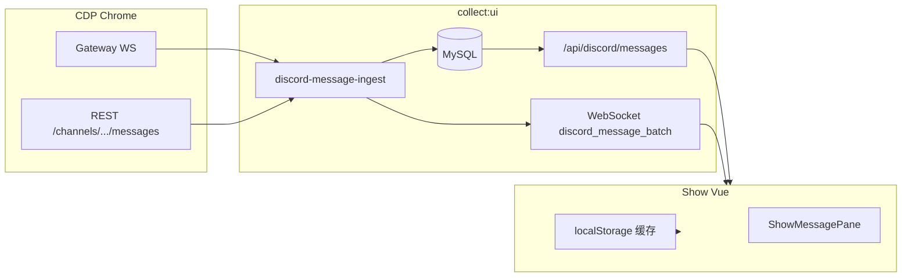

# Show 频道消息与图片展示（技术说明）

面向后续维护：Show 页如何拉历史、如何显示附件/配图、为何多前端不能各自驱动 CDP，以及相关 API / 表字段 / 环境变量。

相关代码：

| 区域 | 路径 |
|------|------|
| Show 主视图 | `collector-ui-vue/src/views/ShowView.vue` |
| 消息列表 UI | `collector-ui-vue/src/components/ShowMessagePane.vue` |
| 附件/合并工具 | `collector-ui-vue/src/lib/discordShow.js` |
| 图片失败缓存 | `collector-ui-vue/src/lib/showAttachmentImages.js` |
| HTTP API | `src/collector-ui-server.js` |
| 消息入库与 REST 批次 | `src/discord-message-ingest.js` |
| 客户端行格式 | `src/discord-message-format.js` |
| 历史预热缓存判断 | `src/discord-show-history-cache.js` |
| CDN 代理 | `src/discord-cdn-proxy.js` |
| MySQL | `src/store.js`（`discord_messages`、`discord_channels`） |

---

## 1. 数据从哪来



1. **Gateway 实时**：新消息带完整 `rawJson`（含 `attachments` / `embeds`），入库后 WS 推前端（推送里带解析好的 `attachments`，不带 `rawJson`，避免 payload 过大）。
2. **REST 批次**：CDP 打开频道、或 Discord 网页上滚时，浏览器会请求 `GET .../messages?before=`；ingest 识别为 `rest_api`，写入/更新库并推 Show。
3. **Show 首屏**：优先 `GET /api/discord/messages`（近 N 天）；可选 `messages-snapshot` 按服预热；本地 `localStorage` 作离线缓存（有版本号与 7 天裁剪）。

消息行到前端的统一转换：`messageRowToClient()` → 从 `raw_json` 调用 `extractAttachmentsForClient()`，API 响应里会去掉 `rawJson`，只留 `attachments` 数组。

---

## 2. 附件与「图片」如何解析

`extractAttachmentsForClient` / 前端 `msgAttachments` 逻辑一致：

1. **`attachments[]`**：`url`、`proxy_url`、filename、content_type 等。
2. **`embeds[].image` / `thumbnail`**：无独立附件时的配图（例如链接预览大图）。
3. 两者**合并去重**（同一 URL 只保留一份）。

展示 URL（`attachmentDisplayUrl`）：

- 优先 `proxy_url`，否则 `url`。
- 凡 Discord CDN 域名（`cdn.discordapp.com`、`media.discordapp.net` 等）→ 走 **`GET /api/discord/cdn-proxy?u=`**，由 Node 带 `Referer: https://discord.com/` 拉取，减轻浏览器直连 403。

是否按图片渲染（`isImageAttachment`）：`content-type` 以 `image/` 开头、常见扩展名、或 URL 路径像 `/attachments/` / 带图片后缀。

加载失败时（`ShowMessagePane`）：

1. 在 direct / proxy 间换源（仍经 cdn-proxy）。
2. 再请求 **`GET /api/discord/messages/:messageId/attachments`**，从库内最新 `raw_json` 重解析 URL 后重试（REST 更新签名后有效）。
3. 仍失败则记入 `showAttachmentImages.js` 的 `failedKeys`，避免同图死循环请求。

---

## 3. 为何有的图能看、有的「图片加载失败」

| 原因 | 说明 | 缓解 |
|------|------|------|
| CDN 签名过期 | Discord URL 带 `ex=` / `hm=`，过期后 404 | REST 重新采集 + `INSERT ... ON DUPLICATE KEY UPDATE raw_json` |
| 库内只有旧 URL | 曾用 `INSERT IGNORE`，REST 不更新已有行 | 已改为 upsert `raw_json` |
| 前端缓存无附件 | localStorage 里旧行无 `attachments` | merge + `v-memo` 含附件指纹，更新后会重绘 |
| 仅 embed 图 | 以前只取 attachments | 已与 embed 合并 |
| 浏览器 403 | 未带 Referer | cdn-proxy |
| 永久标死 | 失败键曾只用 pathname、忽略 `ex=`/`hm=` 新签名 | 已改为含签名；切频道 `resetAttachmentImgDeadCache` |
| 时好时坏 | 直连/代理偶发失败 | 首选直连，onerror 链：另一 CDN 地址 → 代理 → 库内 refresh |

---

## 4. 频道历史预热（多前端共享，不重复刷 CDP）

**问题**：Discord 网页只渲染视口；Show 默认在底部看最新消息，上方历史若未经过 REST，库里可能是过期附件。若每个打开 Show 的浏览器都去 CDP 上滚，会互相抢 Chrome。

**做法**：在 **`discord_channels`** 记服务端缓存（启动时 `ALTER` 自动加列）：

| 列 | 含义 |
|----|------|
| `show_history_warmed_at` | 最近一次 REST 侧认为「已同步历史」的时间 |
| `show_history_oldest_message_id` | 已覆盖到的最旧消息 snowflake（越小越旧） |

`discord-message-ingest` 在 **`rest_api` 批次**入库后调用 `mergeDiscordChannelShowHistoryCache`，扩大 `oldest_message_id` 并刷新 `warmed_at`。

判断是否在 TTL 内已够用：`isChannelShowHistoryFresh()`（`src/discord-show-history-cache.js`）：

- `now - warmed_at < TTL`
- 若指定 `beforeMessageId`（向上翻页锚点），还需 `oldest_synced <= before`（数值上更旧的消息 id 更小）

**API**

| 方法 | 路径 | 作用 |
|------|------|------|
| POST | `/api/discord/channels/show-history-warm` | 未命中缓存时服务端循环 CDP 上滚（默认 4 页）；命中则 `skipped: cache_fresh` |
| POST | `/api/cdp/discord-channel-scroll-up` | 手动上滚一页；若缓存已覆盖该 `beforeMessageId` 则 `cdpSkipped` |
| GET | `/api/discord/messages` | 响应含 `showHistory: { fresh, warmedAtMs, oldestMessageId, ttlMs }` |

同频道并发预热共用一个 in-flight Promise（`showHistoryWarmInflight`）。

**前端**（`ShowView.vue`）：切频道后只调一次 `warmChannelShowHistory()`，不再在浏览器里循环多次 `scroll-up`。

**环境变量**（`config.js` / `.env.example`）：

```bash
DISCORD_SHOW_HISTORY_WARM_TTL_HOURS=12   # 默认 12 小时
DISCORD_SHOW_HISTORY_WARM_PAGES=4
DISCORD_SHOW_SNAPSHOT_DAYS=7             # 与拉库窗口一致
```

---

## 5. 空闲回到底部

在 Show 页 **5 分钟**内无鼠标/键盘操作（`pointerdown`、`keydown`、消息区 `wheel`）时，自动 `scrollMsgsToBottomAfterLayout()` 并开启 `channelStickBottom`，便于长时间挂着看最新消息。

常量：`ShowView.vue` 内 `SHOW_IDLE_JUMP_BOTTOM_MS`（默认 `5 * 60 * 1000`）。程序自动滚底**不会**重置空闲计时（不计入 `scroll` 事件），避免新消息推送把计时器一直顶住。

---

## 6. 切频道滚到最新消息

外层滚动容器是 `.msg-scroll`（`msgsScrollEl`），子组件 `ShowMessagePane` 按 `channelId` 换 key，但 **scrollTop 留在父级**。

行为：

- `channelStickBottom`：切频道置 `true`；用户手动上滚离开底部则置 `false`。
- `scrollMsgsToBottomAfterLayout()`：`nextTick` + 双 `requestAnimationFrame` 后 `scrollTop = scrollHeight`。
- 拉库 / 预热完成后若仍 stick，再次滚底；WS 新消息仅在 stick 时跟滚。

---

## 7. 向上翻页（用户手动）

`onMsgsScroll`：`scrollTop <= 72` 时触发 `loadOlderMessagesForChannel`：

1. `GET /api/discord/messages?before=当前最旧 messageId`
2. 并行 `POST /api/cdp/discord-channel-scroll-up`（缓存命中则服务端跳过 CDP）
3. prepend 后：若在底部则 `scrollMsgsBottom()`，否则 `preserveScrollAfterPrepend`

后台预热（`background: true`）不显示「正在加载更早消息」，且保持 stick 时在底部。

---

## 8. 前端列表合并与性能

`mergeChannelMessages`：按 `messageId` 合并；若新行附件更全或签名变化则覆盖旧行。

`ShowMessagePane` 的 `v-memo` 依赖含 **`messageAttachmentsMemoKey`**，避免「库已补附件但列表不重绘」。

`messageRowMergeSignature` 含附件 URL 指纹，避免过期 URL 更新后不合并。

---

## 9. 运维速查

**重启**：改 `store.js` 迁移或新 API 后需 `pnpm run collect:ui`。

**列不存在**：`show_history_*` 必须在 **`discord_channels`**（勿加到 `discord_messages`）。可手补：

```sql
ALTER TABLE discord_channels
  ADD COLUMN show_history_warmed_at DATETIME(3) NULL AFTER updated_at,
  ADD COLUMN show_history_oldest_message_id VARCHAR(32) NULL AFTER show_history_warmed_at;
```

**强制重新预热某频道**：将该频道行的 `show_history_warmed_at` 置 NULL，或等 TTL 过期后再进频道。

**查单条附件**：`GET /api/discord/messages/{messageId}/attachments`（需库里有该行 `raw_json`）。

**CDN 代理抽测**：`GET /api/discord/cdn-proxy?u=<encode 后的 Discord 图片 URL>`，应返回图片字节流。

---

## 10. 与交易文案的关系

Show 只展示 Discord 已采集的 **文本 + 附件**；频道里的策略说明（如 BTC/ETH 区间、止盈）是消息 `content`，与图片管线无关。图片失败按第 3 节排查，不要和信号卡片 / 自动下单逻辑混查。

---

## 11. 变更摘要（便于 code review）

- `discord_messages`：重复 message_id 时 **更新 `raw_json`**（刷新 CDN 链接）。
- `discord_channels`：`show_history_*` + 预热 API + ingest 写缓存。
- `discord-cdn-proxy` + 附件 refresh API。
- `extractAttachmentsForClient`：attachments + embeds 合并。
- Show：`warmChannelShowHistory`、stick 滚底、`v-memo` 附件键。

若后续改 Show 行为，请同步更新本文档对应章节。
